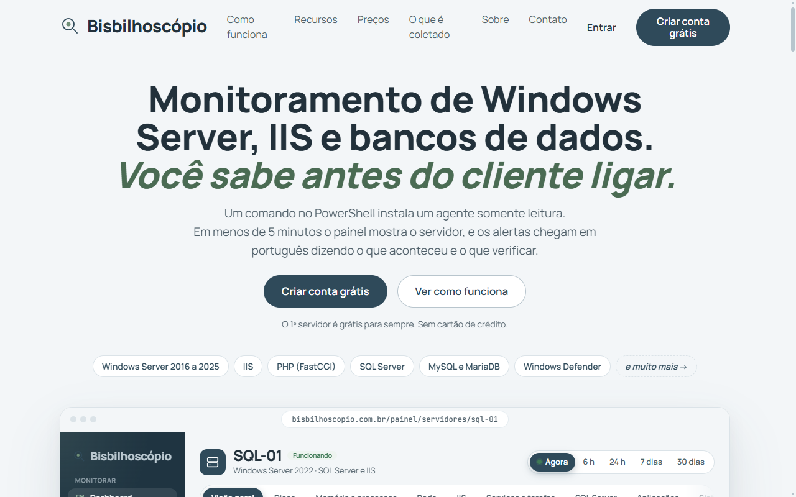
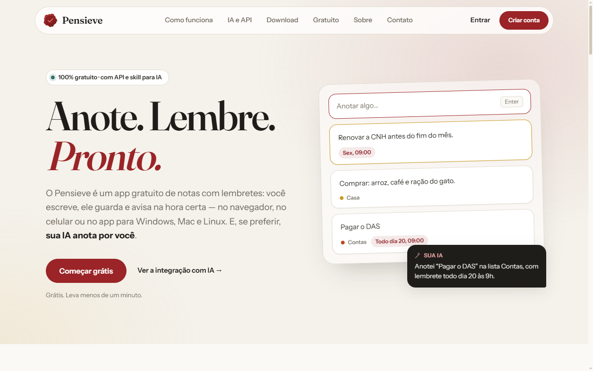
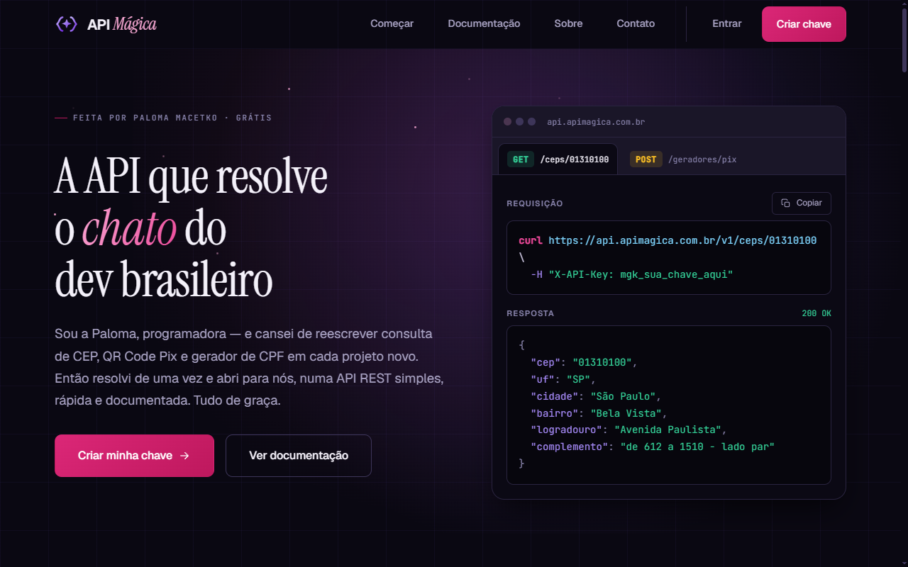
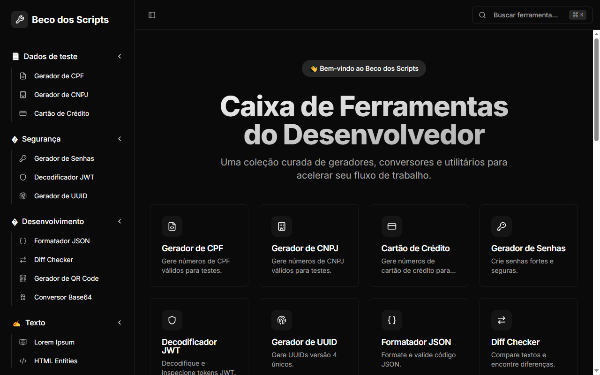
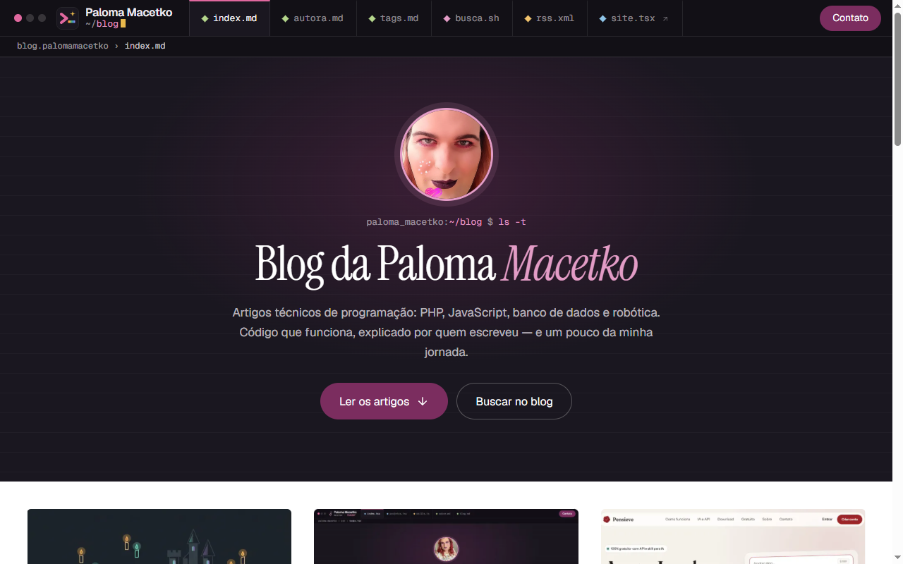

<div align="center">

```bash
~ $ whoami
```

# Paloma Macetko

**Escrevo código há mais de vinte anos.**

Programação · IA · Robótica · Acessibilidade

[](https://www.palomamacetko.com.br/)
[](https://blog.palomamacetko.com.br/)
[](https://www.linkedin.com/in/cmacetko/)
[](https://www.instagram.com/paloma_macetko/)
[](https://www.facebook.com/cmacetko)
[](https://www.npmjs.com/~cmacetko)

</div>

---

## 📄 `cat sobre.md`

Sou desenvolvedora web há mais de duas décadas. Escrevo sobre programação, IA, robótica e acessibilidade, e transformo isso em produtos que gente de verdade usa todos os dias.

Sou mulher trans e cadeirante. **Acessibilidade não é um extra no que eu construo: é requisito desde o primeiro componente.** Navegação por teclado, contraste e leitores de tela entram no projeto junto com o código.

- ♿ **Acessibilidade** — tecnologia feita com atenção a quem usa
- 🧪 **Rigor técnico** — código em produção há mais de vinte anos
- 🤖 **Curiosidade** — robótica, automação e IA sempre no radar

---

## 🚀 `ls -t ~/projetos`

### 🔍 [Bisbilhoscópio](https://www.bisbilhoscopio.com.br/) <sup>`novo`</sup>

> **Monitoramento de Windows Server, IIS e bancos de dados. Alertas que explicam, não só apitam.**

<a href="https://www.bisbilhoscopio.com.br/"></a>

Um comando no PowerShell instala um **agente somente leitura** — ele lê, nunca executa nada. Em menos de 5 minutos o painel mostra o servidor, e os alertas chegam **em português**, dizendo o que aconteceu e o que verificar.

- 🖥️ **O que acompanha:** Windows Server 2016 a 2025, IIS, PHP (FastCGI), SQL Server, MySQL/MariaDB, discos, serviços, backups, rede e segurança do Windows
- 🧠 **Inteligência:** prevê quando o disco vai encher e explica erros e códigos com IA
- 🔔 **Avisos onde você já está:** e-mail, Telegram, Discord, Teams, Slack, navegador, webhook assinado (HMAC-SHA256), PagerDuty, Opsgenie, N8N, Zapier e mais
- ⏱️ **Regras do seu jeito:** limites, duração, escalonamento, horário de silêncio e janelas de manutenção
- 📺 **Extras:** modo TV, relatórios, API e servidor MCP
- 🎁 **O 1º servidor é grátis para sempre**, sem cartão de crédito

---

<table>
<tr>
<td width="50%" valign="top">

### 📝 [Pensieve](https://pensieve.com.br/)

<a href="https://pensieve.com.br/"></a>
*Anote. Lembre. Pronto.*

App gratuito de notas com lembretes, no navegador, celular e computador — com API, skill e servidor MCP para a IA anotar por você.

`React` `Node.js` `MySQL` `Electron` `MCP`

</td>
<td width="50%" valign="top">

### ✨ [API Mágica](https://apimagica.com.br/)

<a href="https://apimagica.com.br/"></a>
*A API que resolve o chato do dev brasileiro.*

API REST gratuita com CEP, QR Code Pix, geradores de CPF e CNPJ e cotação do real, documentada em Swagger.

`Node.js` `Express` `MySQL` `Redis` `OpenAPI`

</td>
</tr>
<tr>
<td width="50%" valign="top">

### 🕵️ [Detector de Cilada](https://detectordecilada.com.br/)

<a href="https://detectordecilada.com.br/"></a>
IA que analisa textos, imagens e e-mails suspeitos e explica se há golpe, phishing ou engenharia social.

`Gemini` `React` `Node.js` `Prisma` `MySQL`

</td>
<td width="50%" valign="top">

### 🧰 [Beco dos Scripts](https://becodosscripts.palomamacetko.com.br/)

<a href="https://becodosscripts.palomamacetko.com.br/"></a>
*Ferramentas de dev que rodam no navegador.*

Geradores, formatador de JSON, JWT, UUID e QR Code — sem anúncios e sem enviar seus dados para lugar nenhum.

`React` `TypeScript` `Tailwind CSS` `shadcn/ui`

</td>
</tr>
<tr>
<td colspan="2" valign="top">

### 📰 [Blog](https://blog.palomamacetko.com.br/)

<a href="https://blog.palomamacetko.com.br/"></a>
Artigos técnicos sobre programação, IA, robótica e os bastidores dos projetos.

`PHP` `SEO/JSON-LD` `Docker` `Gemini`

</td>
</tr>
</table>

---

## 🛠️ `\d+ skills`

**Linguagens e frameworks**<br>


**Bancos de dados**<br>


**Cloud e infraestrutura**<br>


**IA**<br>


**Também:** e-commerce, PIX, gateways de pagamento, marketplaces, SEO/JSON-LD, proteção anti-DDoS e acessibilidade (a11y).

---

## 🌱 `git log --graph`

```text
* 🤖  Produtos com IA e LLMs
* ☁️  Migração para React, Node.js e nuvem AWS
* 💳  Integrações de pagamento e marketplaces
* 🛒  Lojas virtuais e leilões online
* 🐘  PHP artesanal
* 🌐  Primeiro site em ASP clássico
```

<sub>20+ anos no ar, sem reinicializar.</sub>

---

<div align="left">
  
  
  
  
  
  
  
  
  
  
  
  
  
  
  
  
  
  
  
  
  
  
  
  
  
  
  
  
  
  
  
  
  
  
  
  
  
  
  
  
  
  
  
  
  
  
  
  
  
  
  
  
  
  
  
  
  
  
  
  
  
  
  
  
  
  
  
  
  
  
  
  
  
  
  
  
  
</div>

---

<div align="center">


</div>
